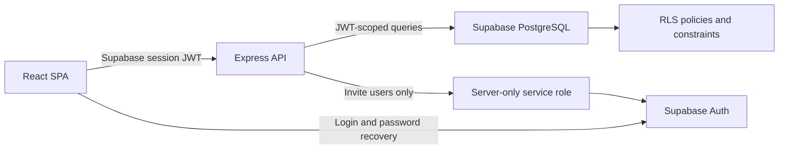

# Stage 1 Architecture

## System Context

## Frontend

The Vite application retains the original interface and uses:

- `AuthContext` for Supabase session lifecycle.
- React Router for login, password reset, protected application, denied, and
  not-found states.
- `AppContext` as a view-state adapter over authenticated API calls.
- No core business records embedded in the production client bundle.
- Persisted dashboard and pilot metrics only; unavailable integration metrics
  are labeled unavailable.

## API

The Express API:

1. Verifies the bearer token through Supabase Auth.
2. Loads the active profile and organization membership.
3. Derives the role from the database, never from browser input.
4. Applies route-level permission checks.
5. Parses mutation payloads with Zod.
6. Queries PostgreSQL with the user's JWT so RLS remains authoritative.
7. Writes audit records for sensitive mutations.

The service-role client is used only for user invitation and profile bootstrap.
It is not imported by browser code.

## Database

Every business table is tenant-scoped with `organization_id`. Core relations
use UUID primary keys, foreign keys, check constraints, indexes, and
tenant-aware uniqueness.

Tables:

- `organizations`
- `profiles`
- `organization_members`
- `organization_member_projects`
- `projects`
- `leads`
- `conversations`
- `handoffs`
- `site_visits`
- `followup_tasks`
- `sla_events`
- `audit_logs`

Lead assignment is an atomic PostgreSQL RPC that updates the lead, handoff,
callback task, SLA event, and audit log in one transaction. A database trigger
synchronizes site-visit status to lead status.

## Data Flow

- Login: browser to Supabase Auth.
- Read: browser to API, API to PostgreSQL under the user JWT.
- Mutation: browser to API, Zod and RBAC checks, RLS-protected write, audit.
- User invitation: owner/admin to API, server-only Admin Auth invitation,
  profile/membership/project-access creation.

## Deployment

`npm run build` creates `dist` and `dist-server`. In production the Express
server serves the SPA and API from one origin. CORS remains allowlist-based for
split-origin deployments.
